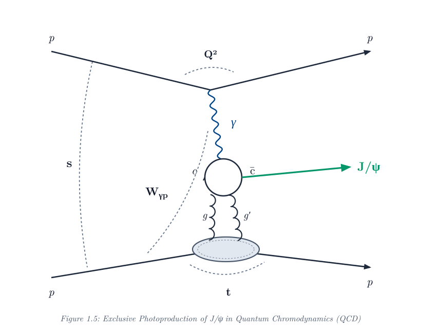
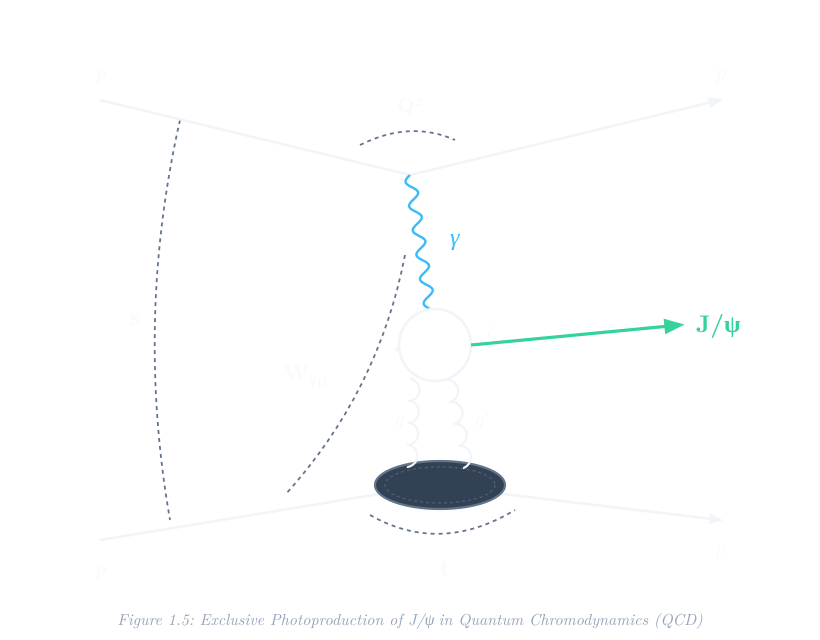

# Analysis of J/ψ Photoproduction in p+p Collisions at √s = 510 GeV with Sartre

**Author**: **Štěpán Skalka**  
*Faculty of Nuclear Sciences and Physical Engineering, Czech Technical University in Prague*  

  
  

## Welcome to the Project Companion & Documentation

This is documentation and analysis of Sartre simulation of **Central Exclusive Photoproduction of $J/\psi$ in proton-proton ($p+p$) Ultra-Peripheral Collisions (UPCs)** at the Relativistic Heavy Ion Collider (RHIC), $\sqrt{s} = 510\text{ GeV}$.

This research builds upon data analysis and simulations done in his Diploma Thesis by **Michal Vranovský**.

### Book Organization

The book is organized into two primary parts:

#### Part 1: Simulation
- **[Setup README](01_sartre_installation_setup.md)**: How to install Sartre 2 and its dependencies and run the simulation.
- **[Sartre Setup Fix](05_sartre_upc_kinematic_fix.md)**: What has to be done to fix the Sartre 2 to be able to run the simulation.
- **[Sartre J/ψ Simulation](07_sartre_simulation_analysis_and_plots.ipynb)**: Main Jupyter Notebook that documents the simulation and post processes the results, producing plots and tables.

#### Part 2: Official Sartre 2 Documentation
- **[Sartre Interactive Documentation Portal](sartre_docs/01_sartre_html_portal.md)**: Gateway to the original Sartre 2 HTML documentation.
- **[Sartre 2 Generator Overview](sartre_docs/02_sartre_overview.md)**: Embedded original `overview.html`.
- **[Sartre 2 User's Guide](sartre_docs/03_sartre_users_guide.md)**: Embedded original `usersGuide.html`.
- **[Ultra-Peripheral Collisions (UPC) Guide](sartre_docs/04_sartre_upc_guide.md)**: Embedded original `UPCconsiderations.html` documenting UPC mode of Sartre 2.
- **[Sartre Runcard Reference](sartre_docs/05_sartre_runcard_ref.md)**: Embedded original `runcardRef.html` documenting all runcard parameters and their default values.
- **[Sartre Event Record Structure](sartre_docs/06_sartre_event_record.md)**: Embedded original `eventRecord.html` documenting data classes and event record structure of Sartre 2.
- **[Technical Code Modifications & Audit Log](sartre_docs/07_code_modifications_summary.md)**: Detailed report of fixes and optimizations applied to Sartre 2.

---

### Important Parameters lookup table

| Parameter | Symbol / Variable | Value | Physical Significance |
| :--- | :--- | :--- | :--- |
| **Collision System** | $p + p$ UPC | $\sqrt{s} = 510\text{ GeV}$ | Protons at $E_{\text{beam}} = 255\text{ GeV}$, Lorentz $\gamma_L = 271.635$ |
| **Decay Channel** | $J/\psi \rightarrow e^+e^-$ | $BR = (5.971 \pm 0.032)\%$ | Clean dilepton signal in STAR TPC/BEMC |
| **Central Acceptance** | Cut C5 | $\vert\eta_e\vert < 0.9$ | STAR central barrel tracking and electron PID |
| **Roman Pot Acceptance** | Cut F2 (Fiducial) | Eq. (4.2), Michal Thesis | Detects forward recoiling protons at small angles |
| **STAR Measured Cross Section** | No RP ($\vert\eta_e\vert < 0.9$) | $650 \pm 40\text{ (stat)}^{+70}_{-50}\text{ (sys) pb}$ | STAR measured fiducial cross section in $e^+e^-$ |
| **STAR Measured Cross Section** | With RP (Cut F2) | $77 \pm 5\text{ (stat)}^{+9}_{-7}\text{ (sys) pb}$ | Clean exclusive sample tagged with Roman Pot |
| **STARlight Cross Section** | No RP ($\vert\eta_e\vert < 0.9$) | $40\text{ pb}$ | Factor $\sim 16\times$ lower than STAR central data |
| **Sartre 2 Total Cross Section** | `bSat_HMPZ` | $35.13\text{ nb}$ ($2097.7\text{ pb}$ in $e^+e^-$) | Color Dipole Model prediction |
| **Sartre 2 Total Cross Section** | `bNonSat_HMPZ` | $39.28\text{ nb}$ ($2345.5\text{ pb}$ in $e^+e^-$) | Non-saturation Color Dipole Model |

---