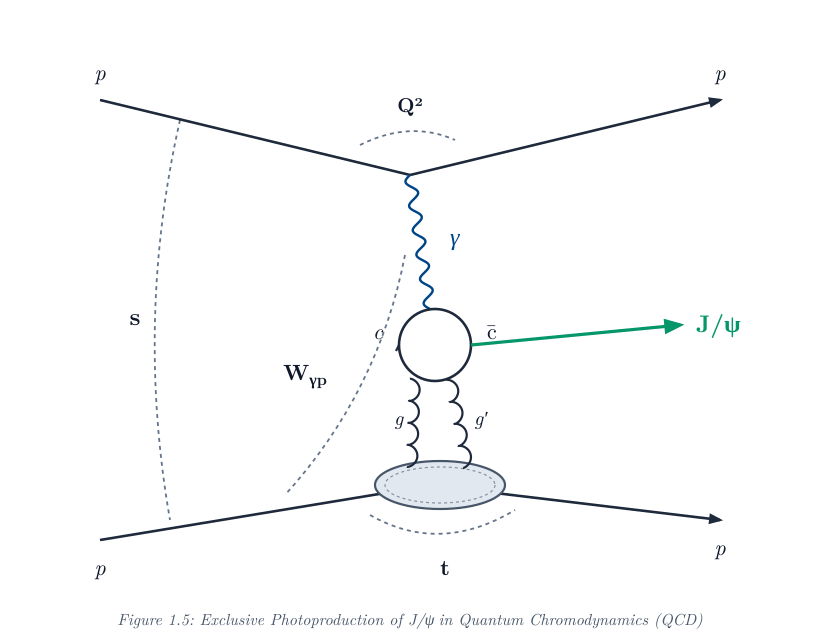
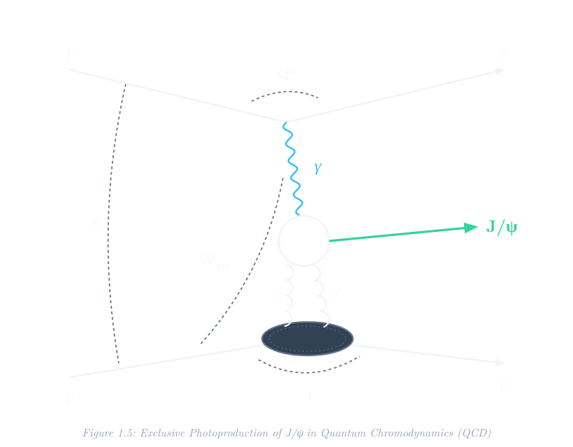

# Analysis of J/ψ Photoproduction in p+p Collisions at √s = 510 GeV with Sartre

**Author**: **Štěpán Skalka**  
*Faculty of Nuclear Sciences and Physical Engineering, Czech Technical University in Prague*  
*STAR Collaboration & Electron-Ion Collider Group*

  
  

## Welcome to the Project Companion & Documentation

This pedagogical interactive book serves as the comprehensive computational and physical companion to the research by **Štěpán Skalka** on **Central Exclusive Photoproduction of $J/\psi$ mesons in proton-proton ($p+p$) Ultra-Peripheral Collisions (UPCs)** at the Relativistic Heavy Ion Collider (RHIC), $\sqrt{s} = 510\text{ GeV}$.

This research builds upon, scrutinizes, and extends the previous experimental measurements and STARlight Monte Carlo simulations documented in the 2026 Diploma Thesis by **Michal Vranovský** (CTU in Prague), titled:
> *"Study of photoproduction of $J/\psi$ in $p+p$ collisions at $510\text{ GeV}$"*

### Core Scientific Questions
1. **Can the Color Dipole Model (Sartre 2) describe exclusive $J/\psi$ photoproduction in $p+p$ collisions at $\sqrt{s} = 510\text{ GeV}$?**
   How do saturation models (`bSat` / `IPsat`) and non-saturation models (`bNonSat` / `IPnonsat`) compare against STAR experimental data?
2. **Where does the STAR data excess come from at $p_T > 0.4\text{ GeV}/c$?**
   Is the discrepancy observed in STAR experimental data without Roman Pots caused by diffractive proton dissociation, electromagnetic bremsstrahlung, or saturation gluon dynamics?
3. **What is the true origin of protons detected in the STAR Roman Pots?**
   Michal Vranovský observed that STARlight Monte Carlo predicted almost zero acceptance for the photon-emitting proton in the Roman Pots. Using Sartre's dual-proton tracking, we answer his **Page 78 hypothesis** with exact quantitative proof:
   - What fraction of Roman Pot hits originate from the Pomeron-target proton vs. the photon emitter?
   - How does transverse-momentum interference affect the recoil distribution?

---

### Key Simulation & Experimental Parameters

| Parameter | Symbol / Variable | Value | Physical Significance |
| :--- | :--- | :--- | :--- |
| **Collision System** | $p + p$ UPC | $\sqrt{s} = 510\text{ GeV}$ | Protons at $E_{\text{beam}} = 255\text{ GeV}$, Lorentz $\gamma_L = 271.635$ |
| **Decay Channel** | $J/\psi \rightarrow e^+e^-$ | $BR = (5.971 \pm 0.032)\%$ | Clean dilepton signal in STAR TPC/BEMC |
| **Central Acceptance** | Cut C5 | $\vert\eta_e\vert < 0.9$ | STAR central barrel tracking and electron PID |
| **Roman Pot Acceptance** | Cut F2 (Fiducial) | Eq. (4.2), Michal Thesis | Detects forward recoiling protons at small angles |
| **STAR Measured Cross Section** | No RP ($\vert\eta_e\vert < 0.9$) | $650 \pm 40\text{ (stat)}^{+70}_{-50}\text{ (sys) pb}$ | STAR measured fiducial cross section in $e^+e^-$ |
| **STAR Measured Cross Section** | With RP (Cut F2) | $77 \pm 5\text{ (stat)}^{+9}_{-7}\text{ (sys) pb}$ | Clean exclusive sample tagged with Roman Pot |
| **STARlight Cross Section** | No RP ($\vert\eta_e\vert < 0.9$) | $40\text{ pb}$ | Factor $\sim 16\times$ lower than STAR central data |
| **Sartre 2 Total Cross Section** | `bSat_HMPZ` | $35.13\text{ nb}$ ($2097.7\text{ pb}$ in $e^+e^-$) | Color Dipole Model prediction |
| **Sartre 2 Total Cross Section** | `bNonSat_HMPZ` | $39.28\text{ nb}$ ($2345.5\text{ pb}$ in $e^+e^-$) | Non-saturation Color Dipole Model |

---

### Book Organization

The book is organized into two primary parts:

#### Part 1: Simulation
- **[Sartre J/ψ Simulation & Cross-Section Analysis](06_sartre_simulation_and_analysis_benchmarks.ipynb)**: Executive simulation and analysis benchmark notebook evaluating baseline Monte Carlo simulations with exact runcards, C++ driver code, ROOT tree kinematics, side-by-side reproduced plots, and cross-section evaluations with and without Roman Pots.

#### Part 2: Official Sartre 2 Documentation
- **[1. Sartre Interactive Documentation Portal](sartre_docs/01_sartre_html_portal.md)**: Interactive gateway providing direct access and full embedded views of the official untouched Sartre 2 HTML documentation suite.
- **[2. Sartre 2 Generator Overview](sartre_docs/02_sartre_overview.md)**: Embedded original `overview.html` documenting physics processes, dipole models, and library design.
- **[3. Sartre 2 User's Guide](sartre_docs/03_sartre_users_guide.md)**: Embedded original `usersGuide.html` documenting C++ programming APIs, memory management, and event loops.
- **[4. Ultra-Peripheral Collisions (UPC) Guide](sartre_docs/04_sartre_upc_guide.md)**: Embedded original `UPCconsiderations.html` documenting photon flux treatment, symmetric beam reversal, and cross-section normalization.
- **[5. Sartre Runcard Reference](sartre_docs/05_sartre_runcard_ref.md)**: Embedded original `runcardRef.html` documenting the runtime configuration parameters.
- **[6. Sartre Event Record Structure](sartre_docs/06_sartre_event_record.md)**: Embedded original `eventRecord.html` documenting data classes, particle statuses, and ancestry indices.
- **[7. Technical Code Modifications & Audit Log](sartre_docs/07_code_modifications_summary.md)**: Detailed report of fixes and optimizations applied to Sartre 2.
